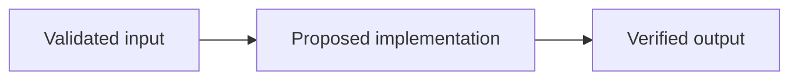

# ADR: Local Stellar integration harness

- **Status:** Proposed, awaiting maintainer approval
- **Date:** 2026-11-19
- **Issue:** #245
- **Scope:** test-only server integration and CI; no unrelated dashboard UI

## Context

Current integration tests need funded public testnet accounts and are skipped in CI. Installed x402/MPP SDKs map only public network identifiers; quickstart local defaults to Standalone Network ; February 2017.

## Decision

1. Propose quickstart --local with NETWORK_PASSPHRASE='Test SDF Network ; September 2015', supported by quickstart start script's local environment override, plus ExactStellarScheme rpcConfig.url pointing to local RPC. This compatibility approach is unproven until tested and needs explicit maintainer approval.

2. Pin quickstart image by immutable digest, start ephemeral RPC and friendbot, bounded readiness polling, per-run random keypairs and no printed secrets.

3. Fund payer, recipient and facilitator; issue test asset, establish trustlines and deploy Stellar Asset Contract.

4. Use test-only x402Facilitator with ExactStellarScheme over random HTTP port and real createHttpFacilitator; Express route must return verifiable receipt.

5. Assert successful RPC transaction and exact balance delta; sequential/concurrent duplicate signatures settle once; underfunded/wrong-amount attempts leave balances unchanged.

6. Opt-in locally and separate CI job with timeout; do not add to aggregate quality until runtime/flakiness approved. Add MPP case only if #100/#101 merges.

## Diagram

## Consequences

Do not monkey-patch SDKs. Proposed network passphrase must never be used for production. Implementation awaits explicit approval of both ADRs.

## Alternatives considered

Skipping architectural approval is prohibited. Mixing currencies, hiding regression failures, and bypassing SDK constraints are not acceptable substitutes for the specified design.

## Verification

First demonstrate local passphrase and SDK compatibility, stop if it fails. Then readiness self-test, on-chain success/duplicates/failures, consecutive CI greens and wall time, preflight, release note.
