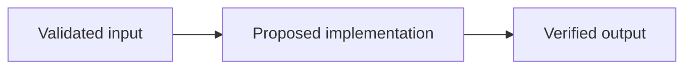

# ADR: Asset-safe observability time series

- **Status:** Proposed, awaiting maintainer approval
- **Date:** 2026-11-19
- **Issue:** #223
- **Scope:** observability package; no unrelated dashboard UI

## Context

The in-memory hub summarizes all outcomes and adds mixed-asset amounts; no time buckets or percentiles exist. The SQL store #217 remains open.

## Decision

1. Add timeseries with 1m, 5m, 1h and 1d UTC epoch-aligned half-open buckets; require valid from/to and reject reversed ranges.

2. Return contiguous bucket envelopes with empty buckets; each populated model (default), payer or payee and asset row reports settled bigint amount as integer string, settled/failed/skipped counts, and p50/p95/p99. Never invent an asset for empty buckets.

3. Nearest-rank percentiles use sorted finite nonnegative latency samples, rank ceil(p*n); no samples means null percentiles. Only settled outcomes contribute amounts.

4. Configurable maxBuckets defaults to 1000, checked before allocating; throw typed TollwayError. Group cardinality remains data-dependent.

5. Preserve legacy summarize fields as deprecated and add byAsset. After approval commit the failing mixed-asset regression test first, confirm failure, then implement.

6. If #217 merges, use its store interface and SQL pushdown for grouping/counts; otherwise use memory, without inventing competing persistence.

## Diagram

## Consequences

Existing totalAmount and other flat maps remain deprecated and cannot be treated as asset-safe. Implementation awaits explicit approval of both ADRs.

## Alternatives considered

Skipping architectural approval is prohibited. Mixing currencies, hiding regression failures, and bypassing SDK constraints are not acceptable substitutes for the specified design.

## Verification

Red-then-green mixed-asset test, UTC boundary, empty bucket, invalid date, outcome, max guard, property invariants and percentile ordering; SQL parity if #217 merged; full preflight, release note and changeset.
