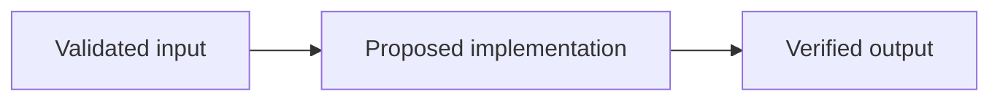

# ADR: Policy decision traces and dry-run

- **Status:** Proposed, awaiting maintainer approval
- **Date:** 2026-11-19
- **Issue:** #200
- **Scope:** core and client packages; no unrelated dashboard UI

## Context

PolicyEngine.check returns the first failure and client emits a skip string. #189 reservations are open; current check/record does not guarantee atomic concurrent budgets.

## Decision

1. Add evaluate(intent) with versioned trace entries for all configured/unconfigured rule families, in existing order, containing id, configured, limit, current, projected, window and pass/fail/not-applicable; amounts as integer strings.

2. Derive enforce check() from same trace with preserved first-failure rule/detail. Use one clock snapshot and avoid trace/decision disagreement.

3. Mode is explicit 'enforce' or 'dry-run', default enforce. Dry-run warns at construction, allows would-be blocks but records spend on successful settlement.

4. Client shadow candidate evaluation reports differences without affecting payments or mutating candidate spend; emit versioned decision event with trace when listeners exist.

5. Preserve existing skip/error behavior; do not include request bodies or headers in traces.

6. If #189 merges use reserve/commit/release for both modes. Otherwise document pre-existing concurrent-budget limitation and do not claim atomic reservation.

## Diagram

## Consequences

Dry-run allows payments that would violate limits; shadow mode cannot change enforcement. Implementation awaits explicit approval of both ADRs.

## Alternatives considered

Skipping architectural approval is prohibited. Mixing currencies, hiding regression failures, and bypassing SDK constraints are not acceptable substitutes for the specified design.

## Verification

Tests for each rule pass/fail/unconfigured/after-failure; randomized trace/check equivalence; dry-run warning and spend recording; shadow non-interference; preflight, release note and core/client changesets.
